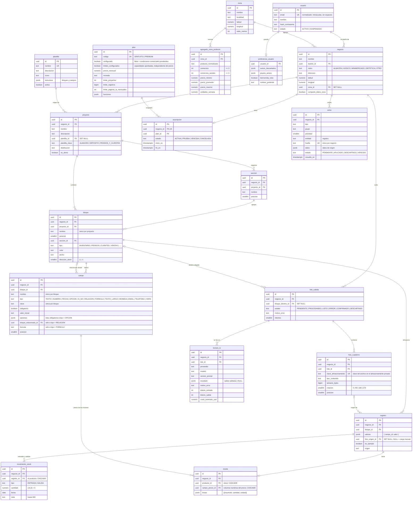

# Modelo de datos (MVP 2 · T-004, T-109; V9 a V12 incorporan frontend, monitoreo y planes)

Fuente de verdad: las migraciones de `backend/src/main/resources/db/migration` (`V1__esquema_inicial.sql`,
`V2__digitalizacion_cuaderno.sql`, `V3__plantillas_base.sql`, `V4__procesamiento_lecturas_ia.sql`,
`V5__campo_relacion.sql`, `V6__campo_formula.sql`, `V7__movimiento_stock.sql`, `V8__receta.sql`,
`V9__modelo_sistema_y_monitoreo.sql`, `V10__datos_prueba_san_justo.sql`, `V11__avisos_entidad_y_datos.sql`,
`V12__planes_y_suscripciones.sql`).
V9 adapta la base al frontend nuevo y al motor de monitoreo de la propuesta v1.3: zona y ubicación del negocio, secciones, atributos de bloque, campo y registro, preferencias de la cuenta, avisos y agregados de zona (sección «Frontend nuevo y monitoreo»). V10 carga datos de prueba de la zona de la UNLaM (San Justo); ver «Datos de prueba». V11 le suma al aviso la entidad que afecta y sus datos de origen.
V5 agrega el tipo de campo `RELACION` (conexión entre tablas del mismo proyecto). V6 agrega `FORMULA` (valor calculado a partir de otros campos numéricos del mismo bloque). V7 agrega el inventario por movimientos (`movimiento_stock`). V8 agrega la receta de un producto (`receta`).
V4 agrega reclamos, reservas y trazabilidad del procesamiento de IA.
V3 carga Inventario, Pedidos y Clientes
como plantillas globales; sus UUID coinciden con los del modo simulado del frontend. Este documento explica el
porqué; si cambian, se actualizan juntos.

## Convenciones

- Nombres en **español, `snake_case`, sin tildes**; tablas en **singular**.
- Clave primaria `id uuid DEFAULT gen_random_uuid()`. Texto siempre `text` (nunca `varchar`).
- Estados y tipos: `text` + `CHECK (... IN (...))` en **MAYÚSCULAS**, espejo de un `enum` Java con `EnumType.STRING`.
- `creado_en` y `actualizado_en` (`timestamptz`) en todas las tablas. Los completa el dominio (el use case pasa el
  `Clock`), no hay `@PrePersist`; el `DEFAULT now()` existe para seeds y scripts.
- Índices al final del script: `ux_` únicos, `ix_` comunes. Constraints con nombre: `ck_`, `fk_`, `ux_`.
- Las migraciones aplicadas **no se editan**: cada cambio es una `V{n}` nueva.

### Procesamiento persistente de IA (V4)

- `lote_subida`: reclamo_id/reclamo_hasta identifican el intento activo; proximo_intento_en
  conserva la demora del reintento; paginas_reservadas/dia_reserva identifican su reserva.
  El token se comprueba al finalizar para descartar respuestas tardías.
- `consumo_ia_diario`: clave primaria (negocio_id, fecha UTC), paginas procesadas y reservadas
  no negativas. Las reservas se actualizan atómicamente con control del límite.
- `lectura_ia`: reclamo_id único para cada intento del worker, propuesta tipada/mapeo JSON,
  dia_consumo (día de la reserva, aun si termina después de medianoche) y consumo_completo.
  Un fallo después de reservar registra páginas con tokens/costo desconocidos y consumo_completo=false.
  V4 conserva e incorpora al contador las lecturas anteriores; no cambia V1–V3.
- Cada escritura final de lectura/estado/consumo comparte una transacción. Las llamadas al proveedor
  y el acceso a archivos ocurren fuera de esas transacciones.

Detalles y contrato con subida: [lectura-cuaderno-ia.md](lectura-cuaderno-ia.md).

## Planes y suscripciones (V12 · ENS-94 / T-066)

- `plan` es un catálogo global con códigos únicos `GRATUITO` y `PREMIUM`, nombre, precio mensual,
  moneda de tres letras, límites de proyectos, registros y páginas de IA mensuales, y una lista JSON de funciones.
  Las cuotas y el precio no admiten números negativos. Se permiten cero y límites nulos según la configuración.
- `configurado=false` identifica las condiciones comerciales todavía pendientes. En ese estado, un límite
  nulo **no significa ilimitado**. El catálogo inicial no fija cuotas, moneda, precio premium ni funciones.
  Sólo el gratuito tiene precio cero. La lista inicial de funciones está vacía y el indicador sigue en falso.
- Un plan configurado exige precio y moneda; el gratuito exige además límites explícitos de proyectos y
  páginas mensuales, y premium exige precio positivo. Un límite nulo en un plan configurado representa
  que no tiene límite para ese recurso. Los valores concretos y las funciones se definen antes de habilitar
  el control comercial de ENS-95. `configurado` no es un permiso premium ni equivale a un pago aprobado.
- `suscripcion` guarda una única suscripción actual por negocio (`ux_suscripcion_negocio`), su plan,
  estado (`ACTIVA`, `PRUEBA`, `VENCIDA`, `CANCELADA`), inicio y fin opcional del período. El fin, si existe,
  debe ser posterior al inicio. La FK del negocio borra en cascada; la FK del plan impide eliminar un plan en uso.
- V12 asigna el gratuito activo, sin fin, a todos los negocios que ya existen, sin borrar sus datos.
  `RegistroService` crea usuario, negocio y suscripción gratuita en una sola transacción: si falla cualquiera,
  se revierte todo. Las fechas de las nuevas cuentas vienen del instante recibido por el caso de uso.
- La consulta de suscripción recibe el negocio resuelto por el servidor; el puerto no ofrece búsqueda por id
  de suscripción sin negocio. `plan` se consulta por código porque es un catálogo global.
- ENS-94 sólo incorpora persistencia y asignación. Los controles efectivos y consumo mensual corresponden
  a ENS-95, la prueba y su vencimiento a ENS-96, la pantalla a ENS-97 y los pagos a ENS-98. Los estados del
  esquema no activan esas operaciones por sí mismos. El límite técnico diario de IA existente sigue funcionando.

## Frontend nuevo y monitoreo (V9)

El frontend llama **sistema** a lo que la base llama `proyecto`: se conservaron los nombres de las tablas y la API hace la
traducción. V9 sólo agrega columnas con `DEFAULT` o nullable y tablas nuevas; no cambia lo que ya existía.

| Front (`lib/sistema/tipos.ts`) | Base | Notas |
|---|---|---|
| `Sistema.template` (`shop`, `warehouse`, `business`) | `proyecto.plantilla_clave` (`ALMACEN`, `DEPOSITO`, `PEDIDOS_Y_CLIENTES`) | Distinta de `plantilla_id`, que apunta a las plantillas globales del backend. |
| `Sistema.layout` (`mosaic`, `single`, `two`, `three`) | `proyecto.distribucion` (`MOSAICO`, `UNA`, `DOS`, `TRES`) | |
| `Sistema.options.movements` / `.expenses` | `proyecto.con_movimientos` / `con_gastos` | |
| `Sistema.demoAlmacen` | `proyecto.es_demo` | |
| `Seccion` | `seccion` (nueva) | FK compuesta a `proyecto`. V9 crea «Vista general» para cada proyecto que ya tenía bloques y le asigna sus bloques. `bloque.seccion_id` queda nullable hasta que la API de sistemas lo exija. |
| `Bloque.type` | `bloque.tipo` (`INVENTARIO`, `PEDIDOS`, `CLIENTES`, `VENTAS`, `GASTOS`, `RESUMEN`, `FORMULARIO`, `NOTA`, `ENTRADAS`, `SALIDAS`) | |
| `Bloque.color` | `bloque.color` (`NARANJA`, `CORAL`, `AMARILLO`, `CELESTE`, `PETROLEO`) | |
| `Bloque.width` | `bloque.ancho` (`TERCIO`, `MEDIO`, `ANCHO`, `COMPLETO`) | |
| `Bloque.description` / `content` / `startRow` | `bloque.descripcion` / `contenido` / `empieza_fila` | `contenido` es el texto de las notas. |
| `Bloque.stockDirection` (`1`, `-1`) | `bloque.direccion_stock` (`1`, `-1`, `NULL`) | |
| `Campo.key` | `campo.clave` | Única por bloque. La usan los avisos y la zona: `name`, `price`, `cost`, `quantity`, `minimum`, `product`… |
| `Campo.type` | `campo.tipo` | `text`→`TEXTO`, `number`→`NUMERO`, `date`→`FECHA`, `select`→`OPCION`, `checkbox`→`SI_NO`, `relation`→`RELACION`; nuevos: `textarea`→`TEXTO_LARGO`, `currency`→`MONEDA`, `email`→`EMAIL`, `tel`→`TELEFONO`, `time`→`HORA`. |
| `Campo.min` | `campo.minimo` | |
| `Campo.target` | `campo.bloque_relacionado_id` | Ya existía (V5). |
| `Fila.__example` / `__source` | `registro.es_ejemplo` / `origen` | |
| `Preferencias` | `preferencia_usuario` (nueva, una fila por usuario) | `descartadas`→`avisos_descartados`, `grupos`→`grupos_avisos`, `bienvenidaVista`→`bienvenida_vista`, `nombre`→`nombre_preferido`. |

Pendiente para cuando se haga `PUT /sistemas`: el frontend genera ids `e<uuid>` y las columnas son `uuid`, así que la API tiene
que traducirlos al guardar; `MONEDA` todavía no cuenta como numérica para fórmulas, recetas ni totales.

### Zona y negocio

- `zona` (global): nombre, localidad, partido, provincia, centro (`latitud`, `longitud`) y `radio_metros`.
- `negocio` suma `rubro` (`ALMACEN`, `KIOSCO`, `MINIMERCADO`, `DIETETICA`, `OTRO`), `direccion`, `localidad`, coordenadas
  (`ck_negocio_coordenadas`: ambas o ninguna), `zona_id` y `comparte_datos_zona`. Si es `false`, el negocio no aporta a los agregados.
- `agregado_zona_producto`: precio mínimo, promedio y máximo, comercios que lo tienen y que lo venden, y unidades por semana de un
  comercio promedio. Es el dato que consume `Zona` del frontend. La privacidad la hace cumplir la base: `comercios >= 3` y
  `comercios_venden >= 3`, así nunca se guarda un dato que identifique a un comercio. Único por `(zona_id, producto_normalizado)`.

### Avisos del motor de monitoreo

`aviso` guarda cada recomendación: `tipo` (`STOCK`, `PRECIO_ZONA`, `ESTANCADO`, `MUY_VENDIDO`, `COMBO`, `CONSUMO_ZONA`), `grupo`
(`STOCK`, `VENTAS`, `ZONA`), `prioridad` (3 urgente, 2 para hoy, 1 para mirar), `huella` (el id estable del frontend, único por
negocio), `titulo`, `detalle`, `motivos` y `acciones` (JSON) y `estado` (`PENDIENTE`, `APLICADO`, `DESCARTADO`, `VENCIDO`).
`resuelto_en` está cargado si y sólo si el aviso se aplicó o se descartó (`ck_aviso_resuelto`): con eso se mide cuántos se aplican
y cuántos se descartan, como pide la propuesta.

V11 suma `entidad` (sobre qué habla el aviso, con la forma `registro:<uuid>`) y `datos` (JSON con los datos de origen). Un índice
único parcial (`ux_aviso_pendiente_entidad`) impide dos avisos pendientes del mismo tipo sobre la misma entidad. La `huella`
pasa a ser `tipo:entidad:hash(datos)`: si los datos de origen no cambian, la huella tampoco, y un aviso descartado o aplicado no
se vuelve a crear.

**Motor de monitoreo.** `MonitoreoAvisosWorker` corre `EjecutarMotorAvisosUseCase` cada `ensambla.avisos.motor.intervalo` ms
(5 minutos por defecto; se apaga con `ensambla.avisos.motor.habilitado=false`). `MotorAvisosService` recibe todas las `ReglaAviso`
registradas como bean, así que una regla nueva no toca el motor. Por cada negocio crea los avisos nuevos, actualiza los que
cambiaron, reactiva los vencidos y vence los pendientes que la regla ya no detecta. Hoy hay una regla, `ReglaStockBajo`.

**API.** `GET /api/avisos[?estado=]` (pendientes primero, del más urgente al menos urgente), `GET /api/avisos/contador`,
`POST /api/avisos/{id}/aplicar` y `POST /api/avisos/{id}/descartar`. Aplicar ejecuta la acción sugerida (`EDITAR_REGISTRO` cambia
valores de un registro por clave de campo; `REGISTRAR` y `ABRIR` son atajos de pantalla) y marca el aviso como aplicado en la misma
transacción. Un aviso de otro negocio responde 404.

## Datos de prueba (V10)

`V10__datos_prueba_san_justo.sql` crea la zona **San Justo - UNLaM** (centro en la universidad, radio 1500 m), 10 comercios
ficticios que aportan a la zona y un negocio **demo** que no aporta. Corre en todos los ambientes, así que si no se quiere en
producción hay que borrarlo antes de publicar.

- Cuentas (misma contraseña de prueba, `Ensambla-Test-2026`): `comercio01@ensambla.test` … `comercio10@ensambla.test` y
  `demo@ensambla.test`.
- Cada comercio tiene el sistema «Mi almacén» (plantilla `ALMACEN`) con una sección «Vista general» y los bloques Inventario,
  Ventas, Clientes y Entradas, con las claves del catálogo del frontend. Lleva ~75 % de un catálogo de 20 productos, con precios
  entre -10 % y +10 % del base, y 60 días de ventas relativas al día en que se aplica la migración.
- El Fernet sólo lo llevan dos comercios, así que no aparece en los agregados (prueba la regla de mínimo 3).
- El demo replica `crearAlmacenDeEjemplo` (`lib/sistema/demo.ts`): stock bajo y agotado, un producto muy vendido y barato, uno caro
  que no se mueve, alfajor y galletitas que salen juntos y productos populares de la zona que no tiene.
- `agregado_zona_producto` se calcula en la misma migración a partir de lo sembrado (sin el demo).
- Los ids se derivan con `md5` de un texto, así que son los mismos en cualquier base.

## Aislamiento entre negocios (T-010, T-011)

Todo lo que construye un usuario cuelga de un **negocio**. Para que sea imposible —aun con un bug en la aplicación—
que un registro apunte a un bloque de otro negocio, las tablas hijas llevan `negocio_id` **denormalizado** y la clave
foránea es **compuesta**: `(negocio_id, bloque_id) → bloque (negocio_id, id)`. La base rechaza cualquier cruce y
`EsquemaPostgresIntegrationTest` lo verifica. En la aplicación, el `negocio_id` sale de la sesión, nunca del request.

## Diagrama

## Tablas

| Tabla | Para qué | Notas |
|---|---|---|
| `usuario` | Cuenta de acceso | `email` único y normalizado por `CHECK`. MVP 2: un único dueño por negocio. |
| `negocio` | Espacio de trabajo y límite de aislamiento | Se crea junto con el usuario en el registro (T-005). `duenio_id` `RESTRICT`. Miembros y roles (dueño / editor / operador) llegan en MVP 4 (T-060) con una tabla nueva. |
| `plan` | Catálogo global de planes (ENS-94 / T-066) | Código único, precio, moneda, límites y funciones; condiciones comerciales iniciales pendientes (`configurado=false`). |
| `suscripcion` | Plan actual de un negocio (ENS-94 / T-066) | Única por negocio, con período y estado. V12 y el registro asignan el gratuito activo. Prueba, control y pagos se agregan en las subtareas siguientes. |
| `plantilla` | Estructuras listas para copiar (T-013) | Global: sin `negocio_id`. `estructura` = `{ "bloques": [ { "nombre", "campos": [ { "nombre", "tipo", "obligatorio", "valorInicial", "opciones" } ] } ] }`. Crear un proyecto desde una plantilla **copia** la estructura; editar el proyecto no toca la plantilla (T-014). |
| `proyecto` | Un sistema armado por el usuario | `plantilla_id` guarda el origen y pasa a `NULL` si la plantilla se borra. Borrar un proyecto borra en cascada bloques, campos y registros (T-012). |
| `bloque` | Una "pieza": Productos, Clientes, Pedidos… | Nombre único por proyecto; `posicion` ordena la lista del constructor. |
| `campo` | Un dato de un bloque, con tipo y reglas | Tipos del MVP 2: texto, número, fecha, opción, sí/no; desde V5, `RELACION` (conexión con otra tabla). `ck_campo_opciones`: `opciones` es un arreglo y, para `OPCION`, no está vacío (T-018). `valor_inicial` es texto y se interpreta según el tipo. Un campo `RELACION` apunta con `bloque_relacionado_id` a un bloque del mismo proyecto (puede ser el propio): FK compuesta `(negocio_id, bloque_relacionado_id)` con `ON DELETE CASCADE` y `ck_campo_relacion` (la columna está cargada si y sólo si el tipo es `RELACION`). El valor en `registro.valores` es el id del registro referenciado; borrar ese registro deja la referencia colgando. La app no deja borrar un bloque usado por un campo de otro bloque. Desde V6, un campo `FORMULA` guarda en `formula` una expresión (`+ - * /`, paréntesis, números y campos citados como `{id-del-campo}`; `ck_campo_formula`: la columna está cargada si y sólo si el tipo es `FORMULA`). Sólo puede citar campos `NUMERO` del mismo bloque, así que no hay referencias circulares. El resultado no se guarda: se calcula al leer los registros. La app no deja eliminar ni cambiar de tipo un campo que usa una fórmula. |
| `movimiento_stock` | Una entrada o una salida de un producto (un `registro` de cualquier bloque) | Desde V7. El stock **no se guarda**: es la suma de entradas menos salidas de cada producto, y una salida no puede dejarlo en negativo (lo valida la app). FK compuesta `(negocio_id, registro_id) → registro (negocio_id, id)` (V7 agrega `ux_registro_negocio_id`) con `ON DELETE CASCADE`: borrar un producto borra su historial. `cantidad` es `numeric(14,3)` mayor a cero. |
| `receta` | Qué insumos (otros registros) y cuánto de cada uno lleva un producto (un `registro`) | Desde V8. Un producto tiene una sola receta (`ux_receta_producto`). `campo_precio_id` es la columna numérica de la que sale el precio de cada insumo (los insumos son filas de su tabla). El costo **no se guarda**: se calcula al leer como la suma de `cantidad × precio actual`; un insumo sin precio o borrado deja la receta como incompleta. `lineas` es un arreglo JSON con la cantidad como texto para no perder decimales; borrar un insumo deja la línea colgando (como una conexión). Borrar el producto o la columna del precio borra la receta (`ON DELETE CASCADE`, FK compuestas por negocio). `unidad` es sólo una etiqueta: la cantidad se expresa en la misma unidad en la que está el precio. |
| `registro` | Una fila cargada en un bloque | `valores` está indexado por **id de campo**, así renombrar un campo no rompe los datos viejos. El validador dinámico (T-022) controla tipo, obligatoriedad y opciones. Desde V2, `foto_origen_id` apunta a la foto de la que salió (T-103, T-104); si se borra la foto queda en `NULL`. |
| `lote_subida` | Una tanda de fotos del cuaderno para leer (T-090) | `estado` es la cola del worker (T-096): `PENDIENTE → PROCESANDO → LISTO` o `ERROR`, y después `CONFIRMADO` o `DESCARTADO`. `ERROR` exige `motivo_error`. `bloque_destino_id` es opcional (sumar a un bloque existente) y pasa a `NULL` si se borra el bloque. |
| `foto_cuaderno` | Cada página subida (T-090) | Sólo guarda la **clave** del archivo en el almacenamiento privado (T-077), nunca la imagen. Tipos permitidos: JPEG, PNG, WEBP, HEIC y PDF. Posición única dentro del lote. |
| `lectura_ia` | Cada intento de leer un lote con IA (T-096, T-098) | Un reintento suma una fila. Tiene `resultado` (JSON ya validado contra el esquema) **o** `motivo_error`, nunca ambos. Guarda proveedor, modelo, versión del prompt, tokens, costo y duración para medir consumo y precisión. |
| `spring_session`, `spring_session_attributes` | Sesiones por cookie (Spring Session JDBC) | DDL oficial; Flyway es su único dueño (`initialize-schema=never`). |

## Índices relevantes

- `ix_proyecto_negocio (negocio_id, creado_en DESC)`: listado de proyectos del negocio.
- `ix_registro_bloque (negocio_id, bloque_id, creado_en DESC)`: paginación de registros (T-026).
- `ix_registro_valores` GIN `jsonb_path_ops` sobre `valores`: búsqueda y filtros por contenido (T-026, T-050).
- `ix_lote_subida_pendiente` parcial (`WHERE estado = 'PENDIENTE'`): el worker toma los lotes en orden de llegada (T-096).
- `ix_lectura_ia_negocio (negocio_id, creado_en DESC)`: consumo de IA por negocio y período (T-098).

Los `ON DELETE SET NULL (columna)` de V2 necesitan PostgreSQL 15 o superior (local y CI usan 17).

## Por qué no hay pgvector (todavía)

La IA ya recibe los bloques del negocio como contexto y devuelve el id del bloque al que conviene sumar las filas
(`LecturaIaJsonMapper` sólo acepta ids del propio negocio), así que el MVP 2 no necesita búsqueda por similitud. Con
pocos bloques por negocio, mandarlos en el prompt es más simple y barato que mantener embeddings. Si más adelante hace
falta buscar registros "parecidos" o deduplicar con muchos datos, se agrega en una migración nueva
(`CREATE EXTENSION vector`, columna `vector(n)` + índice HNSW) y la imagen `pgvector/pgvector:pg17` en Docker y
Testcontainers.

## Qué queda para después

| Necesidad | Cuándo | Cómo se resolvería |
|---|---|---|
| Borrador vs. versión publicada de la estructura | MVP 3 · T-047 | Tablas o columnas de versión en una migración nueva |
| Columnas visibles por bloque y dispositivo | MVP 3 · T-049 | Tabla de preferencias por bloque |
| Membresías y roles, invitaciones, auditoría | MVP 4 · T-060, T-063, T-065 | `membresia`, `invitacion`, `auditoria` |
| Control por plan, prueba, pantalla y cobro | ENS-95 a ENS-98 | ENS-94 incorpora el catálogo y la suscripción inicial; las capacidades se habilitan en sus subtareas |
| Relación entre bloques, stock, recetas | MVP 4 · T-073 a T-075 | Nuevos tipos de campo y tablas de movimientos |
| Repositorios y casos de uso de zona, avisos y preferencias | Cuando se haga el motor de monitoreo | Entidades ya creadas en V9 |
| Archivos adjuntos a registros | MVP 4 · T-078 | Tipo de campo `ARCHIVO` sobre el mismo almacenamiento que `foto_cuaderno` |
| Búsqueda semántica / deduplicación | Cuando haga falta | pgvector (ver arriba) |
| Recuperación de contraseña | MVP 3 · T-039 | Tabla de tokens temporales |
