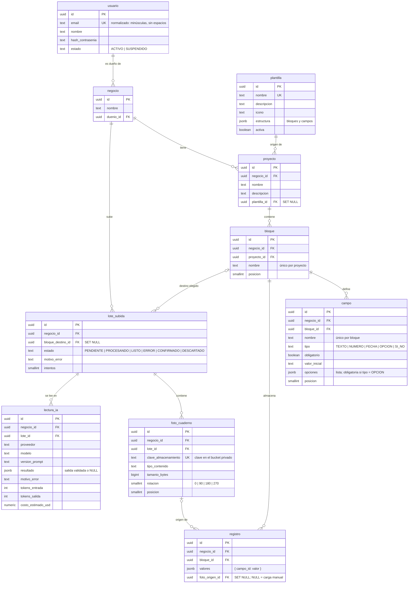

# Modelo de datos (MVP 2 · T-004, T-109)

Fuente de verdad: las migraciones de `backend/src/main/resources/db/migration` (`V1__esquema_inicial.sql`,
`V2__digitalizacion_cuaderno.sql`, `V3__plantillas_base.sql`). V3 carga Inventario, Pedidos y Clientes
como plantillas globales; sus UUID coinciden con los del modo simulado del frontend. Este documento explica el
porqué; si cambian, se actualizan juntos.

## Convenciones

- Nombres en **español, `snake_case`, sin tildes**; tablas en **singular**.
- Clave primaria `id uuid DEFAULT gen_random_uuid()`. Texto siempre `text` (nunca `varchar`).
- Estados y tipos: `text` + `CHECK (... IN (...))` en **MAYÚSCULAS**, espejo de un `enum` Java con `EnumType.STRING`.
- `creado_en` y `actualizado_en` (`timestamptz`) en todas las tablas. Los completa el dominio (el use case pasa el
  `Clock`), no hay `@PrePersist`; el `DEFAULT now()` existe para seeds y scripts.
- Índices al final del script: `ux_` únicos, `ix_` comunes. Constraints con nombre: `ck_`, `fk_`, `ux_`.
- Las migraciones aplicadas **no se editan**: cada cambio es una `V{n}` nueva.

## Aislamiento entre negocios (T-010, T-011)

Todo lo que construye un usuario cuelga de un **negocio**. Para que sea imposible —aun con un bug en la aplicación—
que un registro apunte a un bloque de otro negocio, las tablas hijas llevan `negocio_id` **denormalizado** y la clave
foránea es **compuesta**: `(negocio_id, bloque_id) → bloque (negocio_id, id)`. La base rechaza cualquier cruce y
`EsquemaPostgresIntegrationTest` lo verifica. En la aplicación, el `negocio_id` sale de la sesión, nunca del request.

## Diagrama

## Tablas

| Tabla | Para qué | Notas |
|---|---|---|
| `usuario` | Cuenta de acceso | `email` único y normalizado por `CHECK`. MVP 2: un único dueño por negocio. |
| `negocio` | Espacio de trabajo y límite de aislamiento | Se crea junto con el usuario en el registro (T-005). `duenio_id` `RESTRICT`. Miembros y roles (dueño / editor / operador) llegan en MVP 4 (T-060) con una tabla nueva. |
| `plantilla` | Estructuras listas para copiar (T-013) | Global: sin `negocio_id`. `estructura` = `{ "bloques": [ { "nombre", "campos": [ { "nombre", "tipo", "obligatorio", "valorInicial", "opciones" } ] } ] }`. Crear un proyecto desde una plantilla **copia** la estructura; editar el proyecto no toca la plantilla (T-014). |
| `proyecto` | Un sistema armado por el usuario | `plantilla_id` guarda el origen y pasa a `NULL` si la plantilla se borra. Borrar un proyecto borra en cascada bloques, campos y registros (T-012). |
| `bloque` | Una "pieza": Productos, Clientes, Pedidos… | Nombre único por proyecto; `posicion` ordena la lista del constructor. |
| `campo` | Un dato de un bloque, con tipo y reglas | Tipos del MVP 2: texto, número, fecha, opción, sí/no. `ck_campo_opciones`: `opciones` es un arreglo y, para `OPCION`, no está vacío (T-018). `valor_inicial` es texto y se interpreta según el tipo. |
| `registro` | Una fila cargada en un bloque | `valores` está indexado por **id de campo**, así renombrar un campo no rompe los datos viejos. El validador dinámico (T-022) controla tipo, obligatoriedad y opciones. Desde V2, `foto_origen_id` apunta a la foto de la que salió (T-103, T-104); si se borra la foto queda en `NULL`. |
| `lote_subida` | Una tanda de fotos del cuaderno para leer (T-090) | `estado` es la cola del worker (T-096): `PENDIENTE → PROCESANDO → LISTO` o `ERROR`, y después `CONFIRMADO` o `DESCARTADO`. `ERROR` exige `motivo_error`. `bloque_destino_id` es opcional (sumar a un bloque existente) y pasa a `NULL` si se borra el bloque. |
| `foto_cuaderno` | Cada página subida (T-090) | Sólo guarda la **clave** del archivo en el almacenamiento privado (T-077), nunca la imagen. Tipos permitidos: JPEG, PNG, WEBP, HEIC y PDF. Posición única dentro del lote. |
| `lectura_ia` | Cada intento de leer un lote con IA (T-096, T-098) | Un reintento suma una fila. Tiene `resultado` (JSON ya validado contra el esquema) **o** `motivo_error`, nunca ambos. Guarda proveedor, modelo, versión del prompt, tokens, costo y duración para medir consumo y precisión. |
| `spring_session`, `spring_session_attributes` | Sesiones por cookie (Spring Session JDBC) | DDL oficial; Flyway es su único dueño (`initialize-schema=never`). |

## Índices relevantes

- `ix_proyecto_negocio (negocio_id, creado_en DESC)`: listado de proyectos del negocio.
- `ix_registro_bloque (negocio_id, bloque_id, creado_en DESC)`: paginación de registros (T-026).
- `ix_registro_valores` GIN `jsonb_path_ops` sobre `valores`: búsqueda y filtros por contenido (T-026, T-050).
- `ix_lote_subida_pendiente` parcial (`WHERE estado = 'PENDIENTE'`): el worker toma los lotes en orden de llegada (T-096).
- `ix_lectura_ia_negocio (negocio_id, creado_en DESC)`: consumo de IA por negocio y período (T-098).

Los `ON DELETE SET NULL (columna)` de V2 necesitan PostgreSQL 15 o superior (local y CI usan 17).

## Por qué no hay pgvector (todavía)

La IA ya recibe los bloques del negocio como contexto y devuelve el id del bloque al que conviene sumar las filas
(`LecturaIaJsonMapper` sólo acepta ids del propio negocio), así que el MVP 2 no necesita búsqueda por similitud. Con
pocos bloques por negocio, mandarlos en el prompt es más simple y barato que mantener embeddings. Si más adelante hace
falta buscar registros "parecidos" o deduplicar con muchos datos, se agrega en una migración nueva
(`CREATE EXTENSION vector`, columna `vector(n)` + índice HNSW) y la imagen `pgvector/pgvector:pg17` en Docker y
Testcontainers.

## Qué queda para después

| Necesidad | Cuándo | Cómo se resolvería |
|---|---|---|
| Borrador vs. versión publicada de la estructura | MVP 3 · T-047 | Tablas o columnas de versión en una migración nueva |
| Columnas visibles por bloque y dispositivo | MVP 3 · T-049 | Tabla de preferencias por bloque |
| Membresías y roles, invitaciones, auditoría | MVP 4 · T-060, T-063, T-065 | `membresia`, `invitacion`, `auditoria` |
| Planes, suscripciones, límites | MVP 4 · T-066 | `plan`, `suscripcion` |
| Relación entre bloques, stock, recetas | MVP 4 · T-073 a T-075 | Nuevos tipos de campo y tablas de movimientos |
| Archivos adjuntos a registros | MVP 4 · T-078 | Tipo de campo `ARCHIVO` sobre el mismo almacenamiento que `foto_cuaderno` |
| Búsqueda semántica / deduplicación | Cuando haga falta | pgvector (ver arriba) |
| Recuperación de contraseña | MVP 3 · T-039 | Tabla de tokens temporales |
